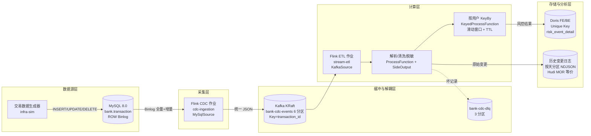
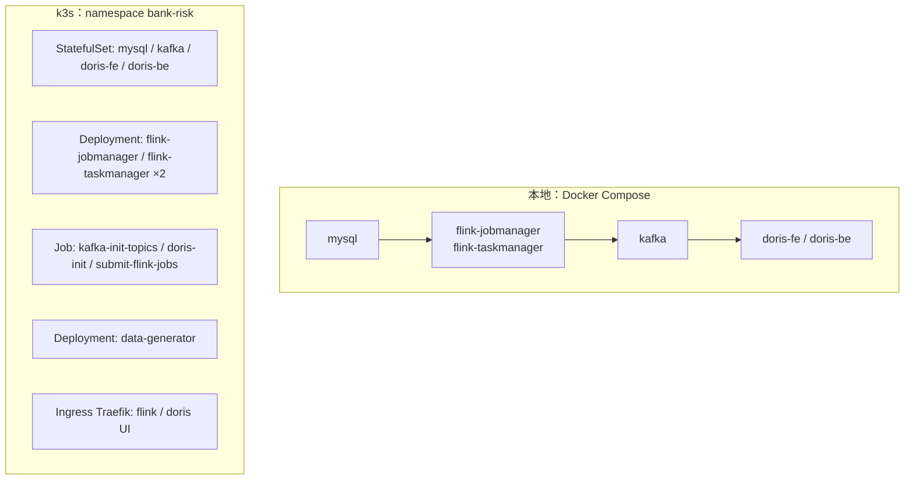
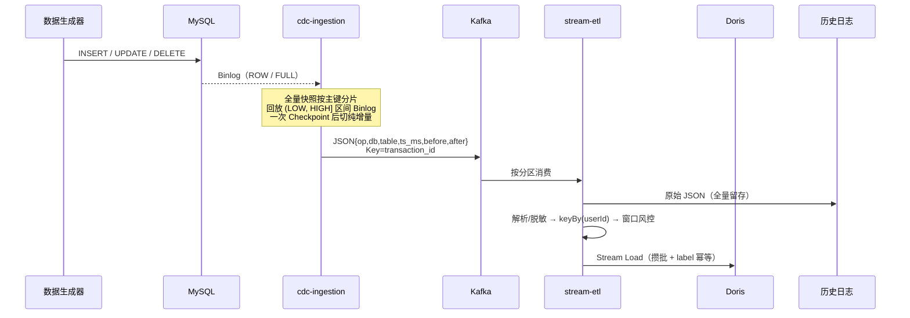

# 架构文档

| 项目 | 内容 |
| :--- | :--- |
| 系统名称 | bank-transaction-risk-stream（银行实时交易风控链路模拟） |
| 文档版本 | v1.0 |
| 适用版本 | 代码 `1.0.0-SNAPSHOT` |
| 读者 | 架构师、开发、运维、测试 |
| 关联文档 | [概要设计](high-level-design.md) · [部署（k3s）](deployment-k3s.md) · [运维 SOP](operations-sop.md) · [测试](testing.md) |

---

## 1. 背景与目标

原有体系为 T+1 批处理，核心数据延迟超过 24 小时，无法支撑实时风控与监控。改造目标：

| 目标 | 指标 | 本工程的实现 |
| :--- | :--- | :--- |
| 实时性 | 端到端秒级可见 | CDC → Kafka → Flink ETL → Doris Stream Load（默认 5s / 200 条攒批） |
| 解耦 | 上游与多个下游互不阻塞 | Kafka 作为变更事件总线，6 分区 |
| 一致性 | 全量 + 增量不重不漏 | Flink CDC 增量快照算法 + Checkpoint |
| 可审计 | 原始变更全量留存 | 历史存储保留 `op / before / after` 完整镜像 |
| 可运维 | 可观测、可恢复、可回放 | DLQ Topic + Savepoint + 巡检脚本 |

> 本工程是**模拟实现**：用于验证链路设计与代码结构，不是生产系统。生产化差异见第 10 节。

---

## 2. 总体架构

物理拓扑（本地 Docker Compose）与 k3s 拓扑形态一致，差别仅在编排方式与存储卷：

---

## 3. 分层与组件职责

| 层 | 组件 | 职责 | 关键约束 |
| :--- | :--- | :--- | :--- |
| 数据源 | MySQL 8.0.39 | 业务库，`bank.transaction` 为捕获表 | `binlog_format=ROW`、`binlog_row_image=FULL`、`server-id=1` |
| 数据源 | `TransactionDataGenerator` | 以固定 seed 持续造数，穿插 UPDATE/DELETE | `tps` 控制速率，程序内建表幂等 |
| 采集 | `cdc-ingestion` | `MySqlSource` 全量快照 + Binlog，转统一 JSON 写 Kafka | 并行度 1；`server-id` 全局唯一；`snapshot.locking.mode=none` |
| 缓冲 | Kafka 3.8.0 KRaft | 变更事件总线，削峰、解耦、多消费方 | 无 ZooKeeper；CDC Topic 6 分区；消息 Key 保证单笔交易有序 |
| 计算 | `stream-etl` | 解析清洗、卡号脱敏、窗口风控、双写 | Checkpoint 30s；状态 TTL 2h；坏记录走 SideOutput |
| 存储/分析 | Doris 2.1.8.1 | 实时风控明细，低延迟查询 | Unique Key 模型；Stream Load 微批；label 幂等 |
| 存储/审计 | 历史变更日志 | 原始 CDC 变更全量留存 | `dt=yyyy-MM-dd` 分区 NDJSON；等价 MOR changelog |
| 运维支撑 | Flink Web UI / DLQ / 脚本 | 作业监控、坏记录回放、冒烟检查 | `scripts/submit-jobs.sh`、`scripts/smoke-test.sh` |

### 组件端口矩阵

| 服务 | 容器端口 | 宿主/Service | 协议与用途 |
| :--- | :--- | :--- | :--- |
| mysql | 3306 | 3306 / `mysql:3306` | MySQL 协议；CDC 账号读 Binlog |
| kafka | 9092 / 9093 | 9092 / `kafka:9092` | PLAINTEXT broker / KRaft controller |
| flink-jobmanager | 8081 / 6123 / 6124 | 8081 | REST UI / RPC / Blob |
| flink-taskmanager | 6122 | — | 数据传输 |
| doris-fe | 8030 / 9030 / 9010 / 9020 | 8030, 9030 | Stream Load HTTP / MySQL 查询 / edit log / RPC |
| doris-be | 8040 / 9050 | 8040 | Web / BE 心跳 |

---

## 4. 数据流

### 4.1 主链路（正常流）

### 4.2 异常流（坏记录）

解析失败（缺字段、金额非法、JSON 损坏）不会抛到主流导致作业重启，而是通过 `OutputTag` 输出到 `bank-cdc-dlq`，内容为 `{error, raw, failed_at}`，可单独消费、修复后回放。

### 4.3 删除事件流

`op=d` 的事件取 `before` 镜像：Kafka Key 仍取 `transaction_id` 保证与前序变更同分区；写入历史变更日志；**不参与风控打分**（`RiskScoringFunction` 直接跳过 `op=d`），避免把撤销行为误判为新交易。

---

## 5. 关键机制

### 5.1 全量与增量无缝衔接

Flink CDC 采用增量快照算法：按主键切 Chunk 并行读取快照，每个 Chunk 记录低位点 LOW / 高位点 HIGH，用 `(LOW, HIGH]` 区间 Binlog 回放还原一致性视图；所有 Chunk 完成后必须等一次成功 Checkpoint 才启动唯一的 Binlog Reader。原理细节见仓库根目录 [`cdc.md`](../cdc.md)「增量快照算法」「Exactly-Once 保证机制」。

### 5.2 端到端一致性

| 环节 | 语义 | 实现 |
| :--- | :--- | :--- |
| MySQL → Flink Source | 精确一次 | Source 参与 Checkpoint，恢复快照进度与 Binlog 位点 |
| Flink → Kafka | at-least-once | `DeliveryGuarantee.AT_LEAST_ONCE` + Checkpoint 位点提交 |
| Kafka → Flink ETL | at-least-once | `OffsetsInitializer` + Checkpoint 提交 offset |
| ETL → Doris | at-least-once（幂等） | Stream Load label 去重；失败批次复用 label 重试 |
| ETL → 历史日志 | at-least-once | 文件追加写 + flush；作业恢复可能重复少量行 |

> 端到端 Exactly-Once 的缺口在 Doris Sink：生产应把 label 绑定 Checkpoint ID，并在 `notifyCheckpointComplete` 提交（官方 Connector 的 2PC 方案）。详见 [概要设计](high-level-design.md#五关键设计决策)。

### 5.3 顺序性保证

`CdcKeySerializationSchema` 以 `transaction_id` 作为 Kafka Key，同一笔交易的 INSERT/UPDATE/DELETE 落在同一分区；Flink 按 `user_id` keyBy 后，同一用户的事件由同一 subtask 顺序处理。这两点是「窗口状态不回退」的前提。

### 5.4 状态治理

- `UserRiskWindow` 只保留窗口内（默认 10 分钟）的事件时间与金额，超出即驱逐，状态大小与窗口长度成正比而非全量历史；
- `ValueState` 配置 TTL（默认 2 小时），自动清理长期不活跃用户；
- 用 `maxSeenEventTime` 防止乱序事件让窗口回退。

### 5.5 容错与恢复

- 两个作业均开启 30s Checkpoint、`maxConcurrentCheckpoints=1`；
- Flink 固定延迟重启（`fixed-delay`, 3 次, 10s）；
- 取消作业时使用 Savepoint，恢复时从 Savepoint 重启，避免重复全量快照；
- 外部化 Checkpoint 保留（`RETAIN_ON_CANCELLATION`）。

---

## 6. 部署视图

| 维度 | 本地 Docker Compose | k3s |
| :--- | :--- | :--- |
| 编排文件 | `infra-sim/docker-compose.yml` | `deploy/k3s/kustomization.yaml` |
| 有状态组件 | 命名卷 + 绑定目录 | PVC（`local-path` StorageClass） |
| 作业提交 | `scripts/submit-jobs.sh`（`docker compose exec flink run`） | `Job: submit-flink-jobs`（`flink run -m`） |
| 服务发现 | 容器 hostname | `<svc>.bank-risk.svc.cluster.local` |
| 外部访问 | 宿主端口映射 | Traefik Ingress |
| 镜像 | 直接拉取 | 自建镜像需 `k3s ctr images import` |

详见 [部署文档（k3s）](deployment-k3s.md)。

---

## 7. 容量与资源（模拟环境基线）

| 组件 | CPU | 内存 | 磁盘 | 备注 |
| :--- | :--- | :--- | :--- | :--- |
| MySQL | 0.5–2 核 | 1–4 GB | 10 GB | Binlog 保留期按磁盘调整 |
| Kafka | 0.5–2 核 | 1–3 GB | 10 GB | 单 broker，`retention.ms=7d` |
| Flink JM | 0.5–2 核 | 1–2 GB | — | 2 个作业共享 |
| Flink TM ×2 | 1–4 核 | 2–4 GB / 个 | 共享卷 | 4 slot，双写时应 ≥ 2 GB |
| Doris FE | 1–2 核 | 2–8 GB | 10 GB | 元数据 |
| Doris BE | 1–4 核 | 2–8 GB | 20 GB | `vm.max_map_count ≥ 2000000` |

在 `tps=20~30` 下，Kafka → Doris 的可见延迟主要由 `doris-flush-interval-ms=5000` 决定；提高 `tps` 时应先扩 TaskManager slot 与 Kafka 分区，再调大 `doris-batch-size`。

---

## 8. 可观测性

| 信号 | 来源 | 关注点 |
| :--- | :--- | :--- |
| 作业状态 / 反压 / Checkpoint 时长 | Flink Web UI `8081`、REST `/jobs/:id/checkpoints` | Checkpoint 超时、失败次数 |
| Kafka 消费积压 | `kafka-consumer-groups.sh --describe` | `LAG` 持续增长说明计算能力不足 |
| Doris 写入结果 | Stream Load 返回 `Status`、Sink 日志 | `Fail`、`LABEL_ALREADY_EXISTS` 频次 |
| DLQ 积压 | `bank-cdc-dlq` offset 差 | 上游数据质量问题 |
| 风控结果分布 | `SELECT level, COUNT(*) ...` | HIGH 占比突增可能为规则或数据异常 |
| 历史日志落盘 | `data/hudi/**/*.ndjson` 文件数与大小 | 磁盘水位 |

---

## 9. 安全与合规

- 卡号在 ETL 阶段脱敏（`622202******1234`），下游 Doris 与历史日志均不存明文；
- DECIMAL 金额以字符串传递，避免浮点精度问题；
- 演示账号口令集中在 `infra-sim/sql/mysql/01-schema.sql`、`deploy/k3s/01-config.yaml` 的 Secret 中，**禁止用于生产**；
- 生产需补齐：TLS、Kerberos/SASL、列级加密、审计日志留存周期、最小权限账号、密钥托管（Vault / K8s Secret 加密）。

---

## 10. 现状与生产化差距

| 项 | 本工程 | 生产建议 |
| :--- | :--- | :--- |
| 副本数 | 全组件单副本 | 3 FE + 3 BE、Kafka 3 broker、Flink HA、MySQL 主从 |
| 状态后端 | `hashmap` + 本地文件 | RocksDB + 增量 Checkpoint + 对象存储 |
| 历史存储 | 本地 NDJSON | Hudi MOR on `s3a://`，开启 `changelog.enabled` |
| Doris 写入 | label 幂等 at-least-once | 官方 Connector 2PC / Checkpoint 绑定 label |
| Schema 变更 | `includeSchemaChanges(false)`，人工同步 | 开启 CDC 3.x Pipeline Schema Evolution |
| 敏感配置 | 明文演示值 | Secret / Vault，静态加密 |
| 监控告警 | 脚本巡检 | Prometheus + Grafana + AlertManager |

---

## 11. 扩展点

1. **新增下游消费方**：直接订阅 `bank-cdc-events`，不影响上游（Kafka 解耦的价值）。
2. **替换 Sink**：实现 `SinkFunction` 或 Sink V2 接口即可换成官方 Doris/Hudi Connector，业务算子不变。
3. **规则可配置化**：`RiskRules` 目前常量在代码中，可外置到配置中心 / 广播流实现热更新。
4. **维度补全**：`bank.user_account` 已建表但未接入，可用 Flink 维表 Join / Lookup Join 扩展。
5. **实时告警**：订阅 Doris 中 `level=HIGH` 或另接一个 Kafka Sink 输出风险事件流。

---

## 12. 附录

- Flink CDC 内部事件模型（`CreateTableEvent` / `DataChangeEvent` / `SchemaChangeEvent` / `FlushEvent`）、Pipeline 拓扑与 Schema Evolution 机制，见仓库根目录 [`cdc.md`](../cdc.md)。
- 本文档中的版本、参数、端口与代码保持一致；如不一致，以代码与 `pom.xml` 为准。
