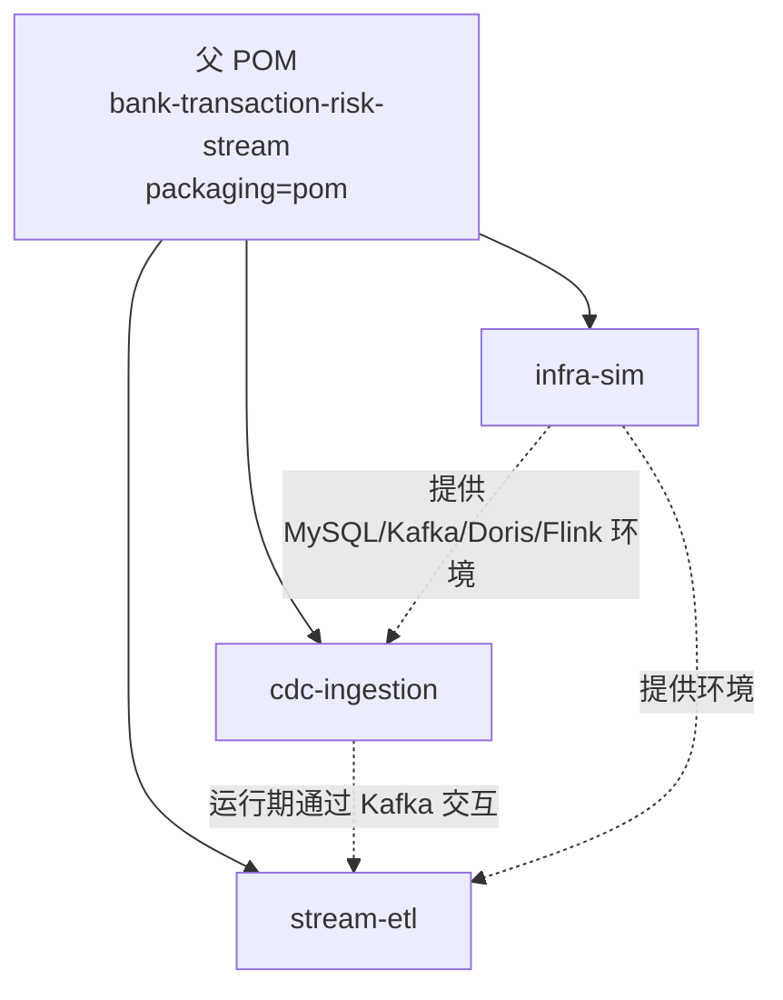

# 概要设计文档

| 项目 | 内容 |
| :--- | :--- |
| 系统名称 | bank-transaction-risk-stream |
| 文档版本 | v1.0 |
| 适用版本 | 代码 `1.0.0-SNAPSHOT` |
| 读者 | 开发、架构师、测试 |
| 关联文档 | [架构文档](architecture.md) · [部署（k3s）](deployment-k3s.md) · [运维 SOP](operations-sop.md) · [测试](testing.md) |

---

## 一、文档说明

本文描述「怎么做」：模块与类的职责、数据模型、接口契约、规则与状态设计、关键决策依据。[架构文档](architecture.md) 描述「是什么」（分层、组件、拓扑），两者互补。所有配置项、字段名、分值均以代码为准；本文与代码不一致时以代码为准。

## 二、设计目标与原则

| 原则 | 落地方式 |
| :--- | :--- |
| 业务与环境解耦 | `infra-sim` 独立模块，只放编排/DDL/造数，不放 Flink 业务代码 |
| 依赖收敛 | 父 POM `dependencyManagement` 统一锁定 Flink / Jackson / Kafka / JUnit 版本 |
| 逻辑可测 | 把解析、规则、窗口、配置解析做成不依赖 Flink 运行时的纯 Java 类，单测无需起集群 |
| 失败隔离 | 坏记录走 SideOutput 到 DLQ，不抛异常终止主流 |
| 顺序性 | Kafka Key = `transaction_id`；Flink 按 `user_id` keyBy |
| 状态可控 | 滑动窗口只保留窗口内数据 + ValueState TTL |
| 契约清晰 | 上下游之间用统一的 CDC JSON，而非透传 Debezium 原始信封 |

---

## 三、模块划分与依赖



**模块之间无编译期依赖**（`A` 与 `B` 不互相 `dependency`），二者仅通过 Kafka 中的 JSON 契约耦合。这是刻意设计：两个作业可以独立构建、独立升级、独立扩缩容。

| 模块 | packaging | 主要依赖 | 产出 |
| :--- | :--- | :--- | :--- |
| 父 POM | `pom` | 仅 `dependencyManagement` / `pluginManagement` | 版本与插件基线 |
| `cdc-ingestion` | `jar` | `flink-connector-mysql-cdc`、`flink-connector-kafka`、`connect-api`、Jackson | Fat Jar（Main-Class `CdcIngestionJob`） |
| `stream-etl` | `jar` | `flink-connector-kafka`、Jackson、slf4j-api | Fat Jar（Main-Class `StreamEtlJob`） |
| `infra-sim` | `jar` | `mysql-connector-j` | 可执行 Fat Jar + compose/SQL/脚本 |

Flink 运行时依赖（`flink-core` / `flink-streaming-java` / `flink-clients` 等）在作业模块中声明为 `provided`，不打进 Fat Jar；由 Flink 集群提供。`maven-shade-plugin` 的 `ServicesResourceTransformer` 负责合并 Connector 的 SPI 描述文件，否则 `flink run` 会找不到 Factory。

---

## 四、模块详细设计

### 4.1 `cdc-ingestion`：MySQL CDC → Kafka

**类清单**

| 类 | 职责 |
| :--- | :--- |
| `CdcIngestionJob` | main；装配 `MySqlSource` + `KafkaSink`，设置 Checkpoint 与并行度 |
| `JobOptions` | 纯 Java 配置解析（`--key value` / `--key=value` / 环境变量 / 默认值）与校验 |
| `CdcEventDeserializer` | 实现 `DebeziumDeserializationSchema<String>`，把 `SourceRecord` 转统一 JSON |
| `CdcKeySerializationSchema` | 实现 `SerializationSchema<String>`，输出 Kafka Key = `transaction_id` |

**作业 DAG**

```
MySqlSource<String>  (uid: mysql-cdc-source, parallelism=1)
        │  WatermarkStrategy.noWatermarks()
        ▼
KafkaSink<String>    (uid: kafka-cdc-sink, AT_LEAST_ONCE)
```

**关键实现点**

- `MySqlSource.builder()` 使用 `startupOptions` 支持 `initial / latest / earliest / snapshot`；`serverId` 必须与 MySQL 及其他 CDC 作业不冲突。
- `debeziumProperties`：`decimal.handling.mode=string`（金额不丢精度）、`snapshot.locking.mode=none`（模拟环境不加全局锁）。
- `includeSchemaChanges(false)`：当前不处理 DDL 变更（生产化建议见第九节）。
- 反序列化器对 `Struct` 逐字段转换，兼容 `DECIMAL`（字符串）、`byte[]`/`ByteBuffer`（Base64）、嵌套 `Struct`/`Map`/`List`；`op` 缺省为 `r`（全量快照）；tombstone（value 为 null）直接忽略。
- 时间戳取值优先级：`source.ts_ms` → `envelope.ts_ms` → `SourceRecord.timestamp()` → 当前系统时间。

**配置参数表**

| 参数 | 默认值 | 校验 |
| :--- | :--- | :--- |
| `mysql-host` / `mysql-port` | `mysql` / `3306` | 端口为正整数 |
| `mysql-user` / `mysql-password` | `cdc` / `cdc123456` | 非空 |
| `mysql-database` / `mysql-table` | `bank` / `bank.transaction` | 非空 |
| `mysql-server-id` | `5401-5404` | — |
| `cdc-startup-mode` | `initial` | 枚举校验 |
| `kafka-bootstrap` / `kafka-topic` | `kafka:9092` / `bank-cdc-events` | 非空 |
| `parallelism` / `checkpoint-interval-ms` | `1` / `30000` | 正整数 |
| `job-name` | `cdc-ingestion` | — |

### 4.2 `stream-etl`：Kafka → 清洗 → 风控 → 双写

**类清单**

| 包 | 类 | 职责 |
| :--- | :--- | :--- |
| 根 | `StreamEtlJob` | main；装配 Source / 算子 / 三个 Sink |
| 根 | `EtlOptions` | 配置解析与校验 |
| `model` | `TransactionEvent` | ETL 内部标准事件模型 |
| `model` | `RiskResult` | 风控结果，字段与 Doris 列一一映射（`@JsonProperty` 下划线命名） |
| `parser` | `TransactionEventParser` | `ProcessFunction`，解析/清洗/脱敏；坏记录侧输出 |
| `rule` | `RiskRules` | 纯函数规则引擎 |
| `rule` | `RiskWindowSnapshot` | 窗口聚合快照（规则引擎输入） |
| `rule` | `UserRiskWindow` | 单用户滑动窗口状态（纯 Java，可单测） |
| `function` | `RiskScoringFunction` | `KeyedProcessFunction`，持有 `ValueState<UserRiskWindow>` 并配置 TTL |
| `sink` | `DorisStreamLoadClient` | Stream Load HTTP 协议客户端（含 307 跟随、label 幂等） |
| `sink` | `DorisStreamLoadSink` | `RichSinkFunction`，攒批 / 定时刷写 / 失败批次重试 |
| `sink` | `HudiChangelogSink` | `RichSinkFunction`，按天分区写 NDJSON 变更日志 |

**作业 DAG**

```
KafkaSource<String>                         uid: kafka-cdc-source
        │
        ▼
ProcessFunction (parse)                     uid: parse-cdc-json
        ├── main output ──┬──> addSink(HudiChangelogSink)      uid: hudi-changelog-sink
        │                 └──> keyBy(userId) -> RiskScoringFunction (uid: risk-scoring)
        │                            └──> addSink(DorisStreamLoadSink)  uid: doris-risk-sink
        └── side output (DLQ_TAG) ──> KafkaSink<String>          uid: dlq-to-kafka
```

> 注：`HudiChangelogSink` / `DorisStreamLoadSink` 是旧版 `SinkFunction`，Flink 1.20 用 `addSink()`；`KafkaSink` 是 Sink V2，用 `sinkTo()`。

**解析与清洗（`TransactionEventParser`）**

| 步骤 | 规则 |
| :--- | :--- |
| 选镜像 | `op=d` 取 `before`，其余取 `after`；若目标镜像为空则回退到另一镜像；两者皆空返回 `null`（丢弃） |
| 金额 | `BigDecimal` 解析（源端以字符串传 DECIMAL）；拒绝负数、非数字 |
| 必填 | `transaction_id`、`user_id` 缺失即抛异常 → DLQ |
| 时间 | `event_time` 支持数字 / 数字字符串 / ISO-8601 / `yyyy-MM-dd HH:mm:ss`；缺省回退 `ts_ms` |
| 脱敏 | `card_no` 保留前 6 后 4，中间替换为 `*` |
| 原文 | `raw` 保存原始 JSON，供历史日志原样落盘 |

DLQ 消息格式：`{"error":"...","raw":"...","failed_at":1730000000000}`。

**状态设计（`UserRiskWindow` + `RiskScoringFunction`）**

```
evaluate(event, rules):
    now = max(maxSeenEventTime, event.eventTime)     # 防乱序回退
    previousCity = lastCity; previousEventTime = lastEventTime
    eventTimes.add(now); amounts.add(event.amount)    # 本笔先计入窗口
    evict(t < now - windowMs)                        # 驱逐过期
    snapshot = (count, totalAmount, previousCity, previousEventTime, windowMs)
    result = rules.evaluate(event, snapshot)         # 纯函数
    lastCity = event.city; lastEventTime = now
    return result
```

- 状态 `ValueState<UserRiskWindow>`，TTL 默认 2 小时（`StateTtlConfig.UpdateType.OnCreateAndWrite`）；
- 窗口长度默认 10 分钟（`risk-window-ms`），状态大小与窗口长度成正比；
- `op=d` 直接跳过，不打分；
- `RiskRules` 与 `UserRiskWindow` 不含 Flink API，可脱离集群做单元测试。

**Doris Sink 设计**

- 攒批触发：`buffer.size() >= doris-batch-size` 或每 `doris-flush-interval-ms` 定时刷写；
- 请求：`POST http://{fe}:8030/api/{db}/{table}/_stream_load`，头 `format=json`、`read_json_by_line=true`、`strip_outer_array=false`、`label=<唯一标签>`、`Authorization: Basic ...`；body 为 NDJSON；
- `307` 由客户端手工跟随（保留 POST body 与全部头）；
- 响应 `Status` 为 `Success` / `Publish Timeout` / `LABEL_ALREADY_EXISTS` 视为成功；其余抛 `IOException`；
- 失败时**保留整个批次并复用同一 label** 下次重试，利用 Doris label 去重避免重复写入；
- 库名/表名用正则 `[A-Za-z0-9_]+` 校验，防止 URL 注入。

**历史日志 Sink 设计**

- 路径：`<base>/dt=yyyy-MM-dd/part-<subtask>-<fileId>.ndjson`（分区按 `Asia/Shanghai` 日期）；
- 每行一条原始 CDC JSON，天然携带 `op / before / after`，等价 Hudi MOR + `changelog.enabled`；
- 支持 `file://` 与普通本地路径，兼容 Windows 盘符写法；
- 每 `hudi-flush-every` 条 flush，`close()` 时强制 flush。

**配置参数表**

| 参数 | 默认值 | 说明 |
| :--- | :--- | :--- |
| `kafka-bootstrap` / `kafka-topic` / `kafka-group` | `kafka:9092` / `bank-cdc-events` / `bank-risk-etl` | 输入 |
| `kafka-startup-mode` | `earliest` | `earliest` / `latest` / `committed` |
| `dlq-topic` | `bank-cdc-dlq` | 坏记录 |
| `doris-fe-host` / `doris-http-port` | `doris-fe` / `8030` | FE HTTP |
| `doris-database` / `doris-table` | `risk` / `risk_event_detail` | Unique Key 表 |
| `doris-user` / `doris-password` | `root` / 空 | FE 账号 |
| `doris-batch-size` / `doris-flush-interval-ms` | `200` / `5000` | 攒批 |
| `hudi-base-path` | `file:///data/hudi/bank_transaction_changelog` | 日志根目录 |
| `hudi-flush-every` | `500` | flush 阈值 |
| `risk-window-ms` | `600000` | 滑动窗口 |
| `risk-high-score` / `risk-medium-score` | `60` / `30` | 等级阈值，且 high > medium |
| `state-ttl-hours` | `2` | 状态 TTL |
| `parallelism` / `checkpoint-interval-ms` / `job-name` | `2` / `30000` / `stream-etl` | 作业级 |

### 4.3 `infra-sim`：环境与造数

| 类 / 文件 | 职责 |
| :--- | :--- |
| `TransactionDataGenerator` | JDBC 持续写入；`ensureSchema` 幂等建表；连接失败时先创建数据库 |
| `GeneratorOptions` | 配置解析与校验（比例之和 ≤ 1） |
| `TransactionFactory` | 以 seed 生成可复现交易；注入大额/黑名单/多城市样本 |
| `Transaction` | 生成器内部数据载体 |
| `docker-compose.yml` | MySQL / Kafka / Flink JM+TM / Doris FE+BE / 一次性初始化服务 |
| `sql/mysql/01-schema.sql` | 业务表 + CDC 账号与授权 |
| `sql/doris/01-risk-tables.sql` | Doris Unique Key 表 |
| `kafka/init-topics.sh` | 幂等创建 6/3 分区 Topic |
| `flink/flink-conf.yaml` | k3s ConfigMap 用的 Flink 配置参考 |
| `scripts/submit-jobs.sh` | 复制 Jar 到 JobManager 并提交两个作业 |
| `scripts/smoke-test.sh` | 端到端冒烟检查 |

生成器每秒插入 `tps` 笔，并按 `update-ratio`（默认 0.15）把最近一笔置为 `SUCCESS` 产生 UPDATE，按 `delete-ratio`（默认 0.02）删除较早记录产生 DELETE，从而覆盖 CDC 的全部变更类型。`seed` 固定时输出序列确定，便于复现测试。

---

## 五、关键设计决策

### 5.1 为什么是「1 父工程 + 3 模块」而不是多个仓库

按数据流阶段拆仓库会导致版本矩阵（Flink / CDC / Kafka Connector）在多处重复维护，且本地联调需要跨仓库协调。单仓库多模块能一次 `mvn clean package` 产出全部制品，父 POM 统一锁版本；模块间无编译依赖，仍保持独立部署能力。

### 5.2 为什么 CDC 与 ETL 是两个作业

两个作业的连接器依赖差异大（CDC Source vs Kafka/Doris Sink），合并会让 Fat Jar 同时携带 Debezium 与 Kafka/Doris 客户端，体积和冲突面都变大；分开后可分别调试、分别扩缩容、分别重启而不互相影响。

### 5.3 为什么用 DataStream API 而不是纯 Flink SQL

需要显式控制三条分支：原始变更 → 历史存储、清洗后事件 → 风控计算 → Doris、坏记录 → DLQ。`ProcessFunction` 的 SideOutput 与 `KeyedProcessFunction` 的状态控制比 SQL 更直观；规则逻辑放在纯 Java 类中也更容易做单元测试。

### 5.4 为什么 Doris / Hudi 不用官方 Connector（重要）

| 依赖 | 实际情况 | 结论 |
| :--- | :--- | :--- |
| `org.apache.doris:flink-doris-connector-1.20:25.0.0` | 其 POM 的 `flink.version` 为 **1.18.0** | 与本工程 Flink 1.20.1 运行时不兼容 |
| `org.apache.hudi:hudi-flink1.20-bundle:1.0.x` | 体积大，且与 CDC Connector 存在 Scala / Parquet 依赖冲突风险 | 模拟环境收益不足 |

因此选择：Doris 用**原生 Stream Load HTTP**（`DorisStreamLoadClient`），Hudi 用**按天分区的 NDJSON 变更日志**（`HudiChangelogSink`）。这两个类都实现为 `SinkFunction`，生产环境版本矩阵匹配后可直接替换为官方 Connector，上游算子无需改动。

> 已踩过的坑：Debezium 会传递旧版 `jackson-core`，导致 `jackson-databind 2.17` 调用 `BufferRecycler.releaseToPool()` 抛 `NoSuchMethodError`；父 POM 已在 `dependencyManagement` 统一锁定 `jackson-core` / `jackson-annotations` / `jackson-databind` 为 2.17.2。

### 5.5 为什么自定义统一 JSON 契约

不透传 Debezium 原始信封，而是收敛成 `{op, db, table, ts_ms, before, after}`：上游加列只影响 JSON 内容，下游反序列化代码不变；下游也不需要引入 Debezium 依赖。DECIMAL 以字符串传输避免精度丢失。

### 5.6 为什么 Kafka Key 选 `transaction_id`

同一笔交易的所有变更必须进同一分区才能保证顺序；若按 `user_id` 分区，同用户的并发交易也会串行化，降低吞吐；若不带 Key 轮询分区，则 UPDATE 可能先于 INSERT 被消费。删除事件取 `before.transaction_id` 以保持 Key 一致。

### 5.7 为什么 `event_time` 用 BIGINT

MySQL `DATETIME` 经 Debezium 会按配置转成不同语义的时间类型（Timestamp / MicroTimestamp / ZonedTimestamp），跨环境容易出错。源表直接用 BIGINT(epoch millis)，CDC JSON 与 ETL 解析都无歧义。

### 5.8 为什么给窗口状态加 TTL

按用户 keyBy 后，若不清理，长期不活跃用户的状态会永久占用 RocksDB。TTL 默认 2 小时，远大于 10 分钟窗口，不影响规则正确性。

---

## 六、数据模型

### 6.1 MySQL `bank.transaction`

| 列 | 类型 | 说明 |
| :--- | :--- | :--- |
| `transaction_id` | `VARCHAR(64)` PK | 流水号，Kafka Key |
| `user_id` | `VARCHAR(32)` | keyBy 维度 |
| `amount` | `DECIMAL(18,2)` | 金额 |
| `currency` | `VARCHAR(8)` | 默认 CNY |
| `status` | `VARCHAR(16)` | INIT / SUCCESS / FAILED |
| `channel` | `VARCHAR(16)` | MOBILE / WEB / POS / ATM |
| `merchant_id` | `VARCHAR(32)` | 商户 |
| `city` | `VARCHAR(32)` | 城市 |
| `card_no` | `VARCHAR(32)` | 源端明文，ETL 脱敏 |
| `event_time` | `BIGINT` | epoch millis |
| `updated_at` | `TIMESTAMP` | 自动更新 |

索引 `idx_user_event(user_id, event_time)`。另有 `bank.user_account` 维表，当前版本未接入（扩展点）。

### 6.2 Kafka 消息契约

`bank-cdc-events`（6 分区）：

```json
{
  "op": "c",
  "db": "bank",
  "table": "transaction",
  "ts_ms": 1730000000000,
  "before": null,
  "after": {
    "transaction_id": "TX000000000001",
    "user_id": "U1001",
    "amount": "12800.00",
    "currency": "CNY",
    "status": "SUCCESS",
    "channel": "MOBILE",
    "merchant_id": "M-001",
    "city": "Beijing",
    "card_no": "6222020000001234",
    "event_time": 1730000001000
  }
}
```

`bank-cdc-dlq`（3 分区）：`{"error": "...", "raw": "...", "failed_at": ...}`。

### 6.3 内部模型 `TransactionEvent` → `RiskResult`

`TransactionEvent` 在解析阶段补齐 `db / table / ts_ms / op / raw`，并做脱敏；`RiskResult` 输出风控结论。二者字段映射如下（Doris 列名由 `@JsonProperty` 显式声明）：

| Doris 列 | 类型 | 来源 |
| :--- | :--- | :--- |
| `transaction_id` | VARCHAR(64) | 事件 |
| `user_id` | VARCHAR(32) | 事件 |
| `event_time` | BIGINT | 事件 |
| `processed_at` | BIGINT | `System.currentTimeMillis()` |
| `op` | VARCHAR(8) | CDC op |
| `amount` | DECIMAL(18,2) | 事件 |
| `city` / `merchant_id` | VARCHAR(32) | 事件 |
| `score` | INT | 规则累加 |
| `level` | VARCHAR(8) | HIGH / MEDIUM / LOW |
| `window_count` | INT | 窗口内笔数（含本笔） |
| `window_amount` | DECIMAL(18,2) | 窗口内累计 |
| `reasons` | VARCHAR(512) | 命中规则，`|` 分隔，无命中为 `NONE` |

### 6.4 Doris 表

`risk.risk_event_detail`，`UNIQUE KEY(transaction_id)`，`DISTRIBUTED BY HASH(transaction_id) BUCKETS 8`，`replication_num=1`（单 BE），`enable_unique_key_merge_on_write=true`。Unique Key 保证同一流水号的重复 Stream Load 覆盖而非追加。

### 6.5 历史变更日志

路径 `<hudi-base-path>/dt=yyyy-MM-dd/part-<subtask>-<fileId>.ndjson`，每行一条原始 CDC JSON。生产替换为 Hudi MOR 表时，可直接把这些 NDJSON 作为 changelog 回放输入。

---

## 七、接口设计

| 接口 | 方向 | 协议 | 契约 |
| :--- | :--- | :--- | :--- |
| MySQL Binlog | MySQL → cdc-ingestion | MySQL replication | ROW / FULL，账号需 `REPLICATION SLAVE/CLIENT` |
| `bank-cdc-events` | cdc-ingestion → stream-etl | Kafka | 统一 JSON，Key=`transaction_id` |
| `bank-cdc-dlq` | stream-etl → 运维 | Kafka | DLQ JSON |
| Stream Load | stream-etl → Doris FE | HTTP POST | NDJSON，`format=json`、`read_json_by_line=true`、`label` 幂等 |
| 历史日志 | stream-etl → 文件系统 | 本地 FS | 按天分区 NDJSON |
| MySQL 查询 | 运维 → Doris FE | MySQL 协议（9030） | `SELECT level, COUNT(*) ...` |

Stream Load 成功响应示例：

```json
{"Status": "Success", "NumberTotalRows": 200, "NumberLoadedRows": 200}
```

`Status` 为 `Fail` 时客户端抛 `IOException`，Sink 保留批次并复用 label 重试。

---

## 八、异常处理设计

| 异常 | 处理方式 | 是否影响主流 |
| :--- | :--- | :--- |
| CDC tombstone / DDL 记录 | 反序列化器忽略 | 否 |
| JSON 损坏 / 缺必填字段 / 金额非法 | SideOutput → DLQ Topic | 否 |
| 删除事件 | 写历史日志，跳过风控打分 | 否 |
| Kafka 暂时不可用 | Flink Checkpoint + 重启策略恢复 | 是（自动恢复） |
| Doris Stream Load 失败 | 保留批次、复用 label 重试；持续失败触发作业重启 | 是 |
| Doris FE 307 重定向 | 客户端自动跟随到 BE | 否 |
| Checkpoint 超时 | 告警，按 SOP 排查反压/资源 | 是 |
| 乱序事件 | `maxSeenEventTime` 防止窗口回退 | 否 |

---

## 九、非功能设计与生产化差距

| 维度 | 当前设计 | 生产改进 |
| :--- | :--- | :--- |
| 一致性 | Doris at-least-once + label 幂等 | label 绑定 Checkpoint ID，`notifyCheckpointComplete` 提交（2PC） |
| 状态后端 | `hashmap` | RocksDB + 增量 Checkpoint + 对象存储 |
| 历史存储 | 本地 NDJSON | Hudi MOR on `s3a://` + compaction |
| Schema 演进 | 关闭 | 开启 CDC 3.x Pipeline Schema Evolution，自动同步 DDL |
| 规则热更新 | 常量在代码 | 广播流 / 配置中心 |
| 高可用 | 单副本 | FE 3 节点、Kafka 3 broker、Flink HA、MySQL 主从 |
| 安全 | 演示明文口令 | TLS、SASL、密钥托管、列级加密、审计留存 |
| 可观测 | 脚本 + Web UI | Prometheus / Grafana / AlertManager |

---

## 十、依赖版本与兼容性

| 依赖 | 版本 | 备注 |
| :--- | :--- | :--- |
| `flink-core` / `flink-streaming-java` / `flink-clients` | 1.20.1 | 作业模块 `provided` |
| `flink-connector-kafka` | 3.4.0-1.20 | 与 Flink 1.20 匹配 |
| `flink-connector-mysql-cdc` | 3.6.0-1.20 | 官方 1.20 构建版本，包名 `org.apache.flink.cdc.*` |
| `connect-api` | 3.7.0 | 反序列化器编译需要（Debezium 未传递到编译期） |
| `jackson-core` / `jackson-annotations` / `jackson-databind` | 2.17.2 | 必须统一，见 5.4 |
| `slf4j-api` | 1.7.36 | `provided`，由集群提供 |
| `mysql-connector-j` | 8.4.0 | 数据生成器 |
| `junit-jupiter` | 5.10.2 | 测试 |
| 插件 | compiler 3.13.0 / surefire 3.2.5 / shade 3.6.0 / exec 3.3.0 | 父 POM `pluginManagement` |

> 版本变更时必须重新验证：`mvn clean package`、`flink run` 提交、Stream Load 写入、Checkpoint 恢复四项。
