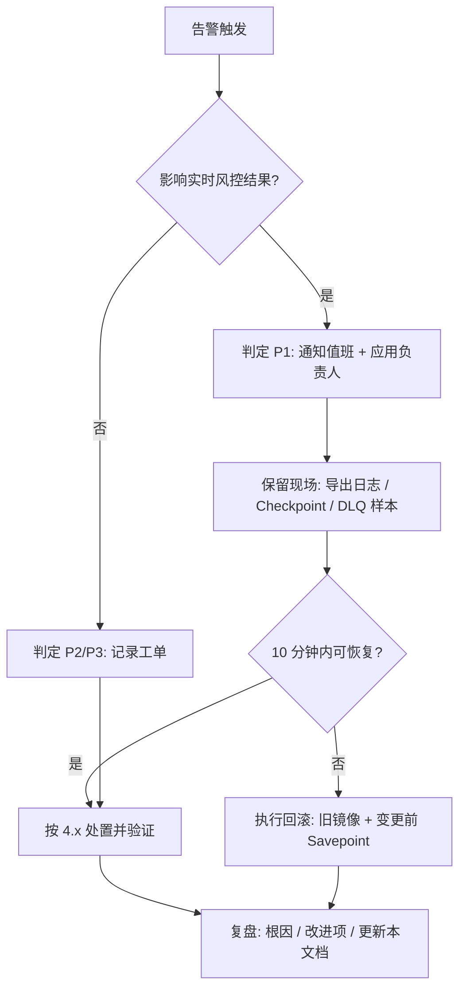

# 运维 SOP 文档

| 项目 | 内容 |
| :--- | :--- |
| 系统名称 | bank-transaction-risk-stream |
| 文档版本 | v1.0 |
| 适用环境 | Docker Compose 本地环境、k3s 联调/演示环境 |
| 关联文档 | [架构文档](architecture.md) · [概要设计](high-level-design.md) · [部署（k3s）](deployment-k3s.md) · [测试](testing.md) |

> 本文中的 Compose 命令默认在 `infra-sim/` 目录执行；k3s 命令默认在 `bank-risk` namespace 执行。文中账号口令为演示值，生产环境请替换为密钥托管中的凭据。

---

## 一、角色与职责

| 角色 | 职责 |
| :--- | :--- |
| 值班运维 | 日常巡检、告警响应、作业启停、扩缩容执行 |
| 数据平台开发 | 作业代码、规则逻辑、Checkpoint/状态问题排查 |
| DBA | MySQL Binlog 保留期、CDC 账号权限、Doris 表与 BE 状态 |
| 应用负责人 | 变更审批、回滚决策、对外沟通 |

**变更原则**：任何配置/代码变更先走 [第五节变更管理](#五变更管理)，保留 Savepoint 与上一版镜像 tag，确保 10 分钟内可回滚。

---

## 二、日常巡检

### 2.1 每日巡检清单

| # | 检查项 | 命令 / 位置 | 期望值 | 异常判据 |
| :-- | :--- | :--- | :--- | :--- |
| 1 | 作业状态 | Flink UI `8081` 或 `flink list` | 2 个作业 `RUNNING` | `FAILING` / `RESTARTING` / `CANCELED` |
| 2 | Checkpoint | Flink UI → Job → Checkpoints | 最近 5 次连续成功，耗时 < 30s | 连续失败 / 耗时 > 2min |
| 3 | 反压 | Flink UI → BackPressure | `OK` | 出现 `HIGH` |
| 4 | Kafka 积压 | `kafka-consumer-groups.sh --describe --group bank-risk-etl` | `LAG` 稳定或趋近 0 | `LAG` 持续增长 > 5min |
| 5 | DLQ 积压 | `GetOffsetShell --topic bank-cdc-dlq` | offset 不增长 | 有新消息即需排查数据质量 |
| 6 | Doris 写入 | `SHOW LOAD ORDER BY CreateTime DESC LIMIT 10\G` | `State: FINISHED` | `CANCELLED` / 大量 `LABEL_ALREADY_EXISTS` |
| 7 | Doris 结果 | `SELECT level, COUNT(*) FROM risk.risk_event_detail GROUP BY level;` | 行数随时间增长 | 长时间不增长 |
| 8 | BE 存活 | `SHOW BACKENDS\G` | `Alive: true` | `Alive: false` |
| 9 | MySQL Binlog | `SHOW BINARY LOGS;` | 有可读取的日志文件、未被提前清理 | CDC 位点对应的 binlog 已删除 |
| 10 | 磁盘水位 | `df -h` / PVC 用量 | < 80% | ≥ 85% 需清理或扩容 |
| 11 | 历史日志落盘 | `find data/hudi -name '*.ndjson' | head` | 当日分区存在 | 无当日分区 |
| 12 | 容器/Pod 状态 | `docker compose ps` / `kubectl get pods -n bank-risk` | 全部 `Up` / `Running` | 反复重启 |

### 2.2 巡检一键命令（Compose）

```bash
cd infra-sim
docker compose ps
docker compose exec -T flink-jobmanager /opt/flink/bin/flink list
docker compose exec -T kafka /opt/kafka/bin/kafka-consumer-groups.sh \
  --bootstrap-server localhost:9092 --describe --group bank-risk-etl
docker compose exec -T kafka /opt/kafka/bin/kafka-run-class.sh kafka.tools.GetOffsetShell \
  --bootstrap-server localhost:9092 --topic bank-cdc-dlq
bash scripts/smoke-test.sh
```

### 2.3 巡检一键命令（k3s）

```bash
kubectl -n bank-risk get pods,pvc
kubectl -n bank-risk exec deploy/flink-jobmanager -- /opt/flink/bin/flink list
kubectl -n bank-risk logs job/doris-init --tail=50
```

---

## 三、作业启停与 Savepoint

### 3.1 查看作业

```bash
# Compose
docker compose exec -T flink-jobmanager /opt/flink/bin/flink list

# k3s
kubectl -n bank-risk exec deploy/flink-jobmanager -- /opt/flink/bin/flink list
```

记录 `JobID`（形如 `00000000000000000000000000000000`），后续操作都需要。

### 3.2 触发 Savepoint（不停作业）

```bash
# Compose：Savepoint 落在挂载目录 /data/flink/savepoints
docker compose exec -T flink-jobmanager /opt/flink/bin/flink savepoint \
  <jobId> file:///data/flink/savepoints

# k3s
kubectl -n bank-risk exec deploy/flink-jobmanager -- \
  /opt/flink/bin/flink savepoint <jobId> file:///data/flink/savepoints
```

返回的 Savepoint 路径（如 `file:///data/flink/savepoints/savepoint-xxxx`）必须记录到变更单。

### 3.3 取消作业并保存 Savepoint

```bash
docker compose exec -T flink-jobmanager /opt/flink/bin/flink cancel \
  -s file:///data/flink/savepoints <jobId>
# 等价的优雅停止（会先完成当前 checkpoint）
docker compose exec -T flink-jobmanager /opt/flink/bin/flink stop \
  --savepointPath file:///data/flink/savepoints <jobId>
```

**取消顺序**：先 `stream-etl`，再 `cdc-ingestion`（先停消费方，避免在途消息无处可去）。**启动顺序相反**：先 `cdc-ingestion`，再 `stream-etl`。

### 3.4 从 Savepoint 恢复

```bash
docker compose exec -T flink-jobmanager /opt/flink/bin/flink run -d \
  -s file:///data/flink/savepoints/savepoint-xxxx \
  /opt/flink/jobs/cdc-ingestion-1.0.0-SNAPSHOT.jar <原有参数...>
```

k3s 版本在 `deploy/k3s/06-submit-jobs.yaml` 的 `flink run` 命令中增加 `-s <savepointPath>`，然后：

```bash
kubectl -n bank-risk delete job submit-flink-jobs --ignore-not-found
kubectl -n bank-risk apply -f deploy/k3s/06-submit-jobs.yaml
```

> 从 Savepoint 恢复时**不要**修改算子 uid、并行度与状态结构（改变窗口长度、增删状态字段），否则状态无法兼容；如必须变更，只能用 `--allow-non-restored-state` 丢弃不兼容状态并接受窗口指标重置。

### 3.5 重新提交（无状态重启）

```bash
# Compose
bash scripts/submit-jobs.sh

# k3s（注意先删除旧 Job，避免重复提交）
kubectl -n bank-risk delete job submit-flink-jobs --ignore-not-found
kubectl -n bank-risk apply -f deploy/k3s/06-submit-jobs.yaml
```

### 3.6 作业启动顺序与依赖


`stream-etl` 默认 `kafka-startup-mode=earliest`，即使先启动也会在 Kafka 有数据后自动消费；但为避免首次全量快照期间 Kafka 堆积过多，仍建议按顺序启动。

---

## 四、常见故障处置

### 4.1 作业 `FAILING` / 反复 `RESTARTING`

| 步骤 | 操作 |
| :--- | :--- |
| 定位 | Flink UI → Job → Exceptions；`docker compose logs --tail=200 flink-taskmanager` / `kubectl -n bank-risk logs deploy/flink-taskmanager` |
| 常见原因 | ① Kafka/Doris 不可达 ② `NoSuchMethodError`（Jar 与集群 Flink 版本不匹配） ③ 反序列化异常 ④ 状态不兼容 |
| 处置 | 依赖类问题先恢复服务；版本类问题重新用 Flink 1.20.1 构建并替换 Jar；状态不兼容则从上一个 Savepoint 恢复，或加 `--allow-non-restored-state` |
| 验证 | 作业 `RUNNING` 且 Checkpoint 连续成功 3 次，Doris 行数恢复增长 |

### 4.2 Flink CDC 读不到 Binlog

| 现象 | 定位 | 处置 |
| :--- | :--- | :--- |
| `The server is not configured as a slave` / 权限错误 | `SHOW GRANTS FOR 'cdc'@'%'` | 补齐 `REPLICATION SLAVE, REPLICATION CLIENT, RELOAD, SELECT` |
| `A slave with the same server_uuid/server_id is reading` | `SHOW PROCESSLIST` | 修改 `--mysql-server-id` 为未占用区间，重新提交 |
| Binlog 位点已被清理 | `SHOW BINARY LOGS;` 对比 Savepoint 位点 | 调大 `expire_logs_days`；无法恢复时用 `--cdc-startup-mode initial` 重新做全量 |
| 快照阶段很慢 | Flink UI 反压 / MySQL 负载 | 降低 `--parallelism`（CDC 建议 1）、调大 `chunk.size`；确认 `snapshot.locking.mode=none` |
| 上游加列后字段缺失 | `includeSchemaChanges(false)`，当前不处理 DDL | 人工同步表结构与解析逻辑，或按生产方案开启 Schema Evolution |

### 4.3 Kafka 消费积压（`LAG` 持续增长）

1. 确认是「生产变快」还是「消费变慢」：对比 Kafka 写入速率与 Flink `numRecordsIn/numRecordsOut`。
2. 消费变慢的排查顺序：Flink 反压 → TaskManager CPU/GC → Doris Stream Load 耗时 → 状态访问耗时。
3. 处置：
   - 扩 TaskManager 副本（k3s：`kubectl -n bank-risk scale deploy/flink-taskmanager --replicas=3`）并按需提高作业并行度（需重新提交）；
   - 提高 `--doris-batch-size`、降低 `--doris-flush-interval-ms` 上限压力；
   - 必要时扩 Kafka 分区（**只能增不能减**），并同步提高 ETL 并行度。
4. 验证：`LAG` 在 10 分钟内收敛，Checkpoint 不超时。

### 4.4 Doris Stream Load 失败

| 现象 | 定位 | 处置 |
| :--- | :--- | :--- |
| Sink 日志 `Stream Load 失败，批次保留待重试` | 查看日志中的 `Status` / HTTP code | 见下 |
| `Connection refused` | `curl http://doris-fe:8030/api/health` | 恢复 FE；确认 `--doris-fe-host` / `--doris-http-port` |
| HTTP 307 未跟随 / 重定向到不可达 BE | 客户端日志、`SHOW BACKENDS\G` | 恢复 BE；确认 BE_ADDR 与容器 DNS 一致 |
| `Status: Fail`（如 `too many filtered rows`） | `SHOW LOAD` 的 `URL` 查看错误明细 | 检查 JSON 列与 Doris 表列名/类型是否一致（尤其新增字段） |
| 大量 `LABEL_ALREADY_EXISTS` | 正常重试幂等现象 | 无需处理；持续出现说明上游在反复重发同一批，检查作业是否被反复重启 |
| 表不存在 | `SHOW TABLES FROM risk;` | 重新执行 `sql/doris/01-risk-tables.sql` 或重跑 `doris-init` Job |

> Sink 会保留失败批次并复用同一 label 重试，因此**短时间内 Doris 不可用不会丢数据**，但会持续占内存；超过 15 分钟未恢复应暂停作业并告警。

### 4.5 Checkpoint 超时 / 失败

1. 看 Flink UI Checkpoint 详情中的 `Alignment Duration`、`Async Duration`、失败算子。
2. 常见原因：反压（Kafka 积压）、状态膨胀（TTL 未生效）、`/data/flink` 本地卷 IO 慢、并发 Checkpoint。
3. 处置：先解决积压；确认 `execution.checkpointing.max-concurrent-checkpoints=1`；生产改用 RocksDB + 增量 Checkpoint + 对象存储；必要时临时调大 `--checkpoint-interval-ms`（会降低恢复精度，需审批）。
4. 验证：连续 5 次 Checkpoint 成功。

### 4.6 DLQ Topic 出现消息

```bash
# 查看坏记录样本
docker compose exec -T kafka /opt/kafka/bin/kafka-console-consumer.sh \
  --bootstrap-server localhost:9092 --topic bank-cdc-dlq \
  --from-beginning --max-messages 10
```

消息体为 `{error, raw, failed_at}`。按 `error` 分类（`缺少必填字段` / `金额不是合法数字` / `金额不能为负数` / `空消息`），定位上游数据质量问题；修复后可用 `kafka-console-producer.sh` 把 `raw` 回放到 `bank-cdc-events` 重新处理（**注意幂等**：Doris 为 Unique Key，同 `transaction_id` 会覆盖）。

### 4.7 磁盘水位过高

| 目录 | 内容 | 处置 |
| :--- | :--- | :--- |
| `data/hudi` / PVC `hudi-data` | 历史变更日志 | 按 `dt=` 分区归档到对象存储后删除旧分区（需先确认合规留存期） |
| `data/flink` / PVC `flink-checkpoints` | Checkpoint / Savepoint | 清理过期 Checkpoint（保留最近 N 个 + 所有 Savepoint） |
| Kafka / MySQL 数据卷 | Topic 日志、Binlog | 调整 `retention.ms` / `expire_logs_days`；扩容 PVC |

**禁止**直接删除正在被作业使用的 Checkpoint 目录或 Savepoint。

### 4.8 状态膨胀 / 用户维度倾斜

现象：某个 TaskManager 内存持续上涨、Checkpoint 变大。排查：是否出现大量不同 `user_id`（如上游把 `user_id` 写成随机值）、`state-ttl-hours` 是否被误设为 0、`risk-window-ms` 是否被调得过大。处置：修正 TTL 与窗口配置，重新提交；必要时对热点 key 做拆分。

---

## 五、变更管理

| 阶段 | 要求 |
| :--- | :--- |
| 变更申请 | 说明变更内容、影响范围、回滚方案、验证用例 |
| 变更前 | `mvn clean package` 全绿；触发两个作业的 Savepoint 并记录路径；记录当前镜像 tag / Jar 版本 |
| 变更窗口 | 避开批量结算高峰；先停消费方再停生产方 |
| 灰度 | 先在 Compose 环境验证，再上 k3s；先提交 `cdc-ingestion`，观察 5 分钟再提交 `stream-etl` |
| 验证 | 执行 [测试文档](testing.md#五端到端测试用例) 的冒烟用例，确认 Doris 行数增长、DLQ 无新增、Checkpoint 成功 |
| 回滚 | 10 分钟内无法恢复即回滚：取消新作业 → 用旧 tag 镜像 + 变更前的 Savepoint 恢复 |

---

## 六、扩缩容 SOP

```bash
# k3s 扩 TaskManager
kubectl -n bank-risk scale deploy/flink-taskmanager --replicas=3
# 提高造数速率
kubectl -n bank-risk set env deploy/data-generator TPS=100
# Compose 扩 TaskManager
docker compose up -d --scale flink-taskmanager=3
```

顺序：**先扩容 → 观察 LAG 收敛 → 再提高负载**。缩容前必须触发 Savepoint，缩容后用新并行度重新提交。注意 `--parallelism` 在提交时固定，单纯扩容 Pod 不会自动提高作业并行度。

---

## 七、备份与恢复

| 对象 | 备份方式 | 恢复方式 | 建议频率 |
| :--- | :--- | :--- | :--- |
| Flink Savepoint | `flink savepoint <jobId> file:///data/flink/savepoints` | `flink run -s <path> ...` | 每次变更前后 |
| Checkpoint | 外部化保留（`RETAIN_ON_CANCELLATION`） | 自动 / 手动指定恢复 | 30s 自动 |
| MySQL | `mysqldump` + Binlog 保留 | 恢复备份 + 重放 Binlog；CDC 重新做全量 | 每日 |
| Doris | `BACKUP` 到仓库 / 导出结果表 | `RESTORE` 或从历史日志重放 | 每日 |
| 历史变更日志 | `dt=` 分区归档到对象存储 | 回放 NDJSON 到重建作业 | 每周 |
| 配置清单 | 纳入 Git（`deploy/k3s/`、`infra-sim/`） | `git checkout` | 每次变更 |

**恢复演练**：每季度至少一次从 Savepoint + 归档日志完整恢复，记录 RTO/RPO。

---

## 八、告警指标与阈值建议

| 指标 | 来源 | 建议阈值 | 级别 |
| :--- | :--- | :--- | :--- |
| 作业非 `RUNNING` | Flink REST `/jobs` | 持续 1 分钟 | P1 |
| Checkpoint 连续失败 | Flink REST `/jobs/:id/checkpoints` | ≥ 3 次 | P1 |
| Checkpoint 时长 | 同上 | > 2 min | P2 |
| Kafka `LAG` | consumer group | > 10000 且持续增长 5 min | P2 |
| Doris Stream Load 失败 | Sink 日志 | 5 分钟内 ≥ 3 次 | P1 |
| Doris BE 不存活 | `SHOW BACKENDS` | `Alive: false` | P1 |
| DLQ 新增消息 | Topic offset | 5 分钟内 > 0 | P3 |
| 磁盘使用率 | 节点 / PVC | ≥ 85% | P2 |
| 风控 HIGH 占比 | Doris 查询 | 环比突增 > 3 倍 | P3（需人工研判） |

---

## 九、应急处置流程



**处置顺序**：保住数据不丢（先确认 Kafka 与 Binlog 未过期）→ 恢复作业 → 补跑缺失数据 → 复盘。切勿在原因未明时反复重启作业或删除 Checkpoint。

---

## 十、附录：命令速查

### Docker Compose（在 `infra-sim/` 执行）

```bash
docker compose up -d                          # 启动全部
docker compose ps                             # 状态
docker compose logs -f --tail=100 flink-taskmanager
docker compose exec -T flink-jobmanager /opt/flink/bin/flink list
docker compose exec -T mysql mysql -uroot -proot -e "SHOW MASTER STATUS\G"
docker compose exec -T kafka /opt/kafka/bin/kafka-topics.sh --bootstrap-server localhost:9092 --list
docker compose down -v                        # 停止并清卷（危险，确认后再执行）
bash scripts/submit-jobs.sh                   # 提交作业
bash scripts/smoke-test.sh                    # 冒烟
```

### k3s

```bash
kubectl -n bank-risk get pods,pvc,svc,jobs
kubectl -n bank-risk logs -f deploy/<name>
kubectl -n bank-risk exec deploy/flink-jobmanager -- /opt/flink/bin/flink list
kubectl -n bank-risk exec deploy/mysql -- mysql -uroot -proot -e "SHOW BINARY LOGS"
kubectl -n bank-risk delete job submit-flink-jobs --ignore-not-found
kubectl apply -k deploy/k3s                   # 应用基础资源
kubectl -n bank-risk apply -f deploy/k3s/06-submit-jobs.yaml
kubectl delete -k deploy/k3s                 # 卸载
```

### Doris（MySQL 协议 9030）

```sql
SHOW BACKENDS\G
SHOW LOAD ORDER BY CreateTime DESC LIMIT 10\G
SELECT level, COUNT(*) FROM risk.risk_event_detail GROUP BY level;
SELECT * FROM risk.risk_event_detail WHERE level='HIGH' ORDER BY event_time DESC LIMIT 20;
```

> ⚠️ 破坏性命令（`down -v`、`delete -k`、`delete pvc --all`、删除 Savepoint）必须双人确认并留存变更单。
